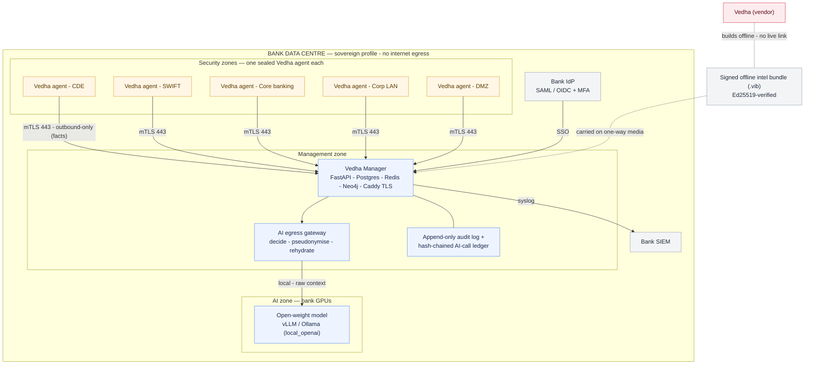
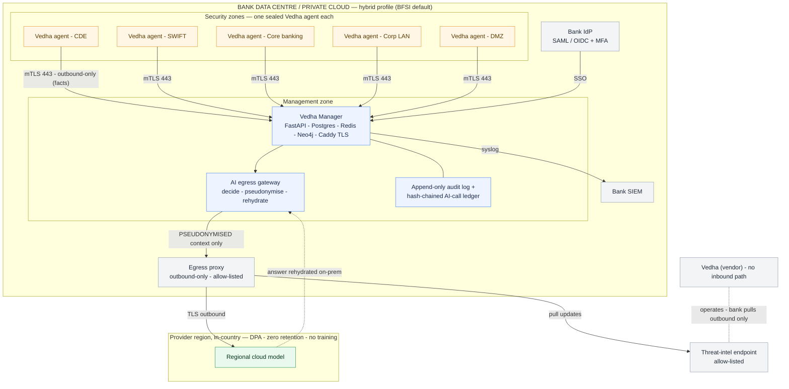

# ADR-0003 — BFSI deployment architecture and the AI egress gateway

Status: accepted and implemented (items still marked *planned* below are tracked in
`docs/superpowers/plans/2026-09-24-intel-tags-domain-ai-bfsi-plan.md`)
Date: 2026-09-24

## 1. Context — what a bank's security and vendor-risk teams will ask

Banks, NBFCs, insurers, brokers and payment companies buy Vedha under outsourcing and
third-party-risk rules, not just as a tool. The questions they ask are the same in every
region, with local names:

| Concern | India | EU / UK | Middle East / APAC | US |
|---|---|---|---|---|
| Where data lives | RBI payment-data storage directive (2018): payment data stored only in India; DPDP cross-border rules | GDPR Ch. V transfers | SAMA / CBUAE data residency expectations; MAS outsourcing guidelines | Contractual; state rules |
| Vendor / outsourcing risk | RBI Master Direction on Outsourcing of IT Services (2023) | DORA Art. 28–30 (ICT third-party risk, register of information, contract terms) | SAMA outsourcing rules; MAS Outsourcing Guidelines | NYDFS §500.11 third-party service provider policy |
| Logs and reporting | CERT-In: 180-day logs kept in India, 6-hour incident reporting | DORA Art. 19 / NIS2 Art. 23 | MAS 1-hour notification | NYDFS 72h; bank regulators 36h |
| Vendor access | No persistent vendor remote access; access has to be approved and recorded | Same | Same | Same |
| Change control | Scanning is a production change and needs approval plus a change window | Same | Same | Same |

What follows from this: **the bank's raw security data must not leave the bank unless the
bank has allowed it, Vedha (the vendor) has no inbound path, and every AI answer has to be
explainable and auditable.**

## 2. Decision — one codebase, three deployment profiles, one egress gateway

`DEPLOYMENT_PROFILE` (manager setting) selects the profile. Every model call goes through the
gateway (`app/ai/gateway.py`), at the single egress point in `ManagerLlmService._dispatch` and
in the two direct-SDK callers (report generator, advisor agent).

| Profile | Typical buyer | Manager and data | AI | Threat-intel / updates |
|---|---|---|---|---|
| `sovereign` | Tier-1 banks, central-bank-regulated entities, air-gapped sites | Bank data centre, no internet egress | Open-weight model on bank GPUs: `LLM_PROVIDER=local_openai` (vLLM/TGI/any OpenAI-compatible server at an internal `LOCAL_LLM_BASE_URL`) or `ollama`. **Cloud providers are refused (fail closed).** | Signed offline bundles carried in one way (`python -m app.intel.bundle`, `POST /admin/intel-bundle`) |
| `hybrid` (BFSI default) | Most banks, NBFCs, insurers, brokers | Bank data centre or the bank's private cloud tenancy | Cloud model in the bank's region, **after pseudonymization**. Local models receive raw data. | Outbound-only pull from an allow-listed endpoint |
| `cloud` | Fintechs and startups | Vedha single-tenant, in-region, customer-managed keys | Cloud, raw (or `AI_PSEUDONYMIZE=true`) | Automatic |

### 2.1 What the gateway does (implemented)

* **Decides:** each call is allowed raw, allowed pseudonymized, or refused, according to the
  profile and the runtime's privacy class (`local` or `cloud`).
* **Pseudonymizes:** IPv4/IPv6 addresses, hostnames/FQDNs (including values under structured
  keys such as `hostname`), e-mails, `DOMAIN\user` accounts and MAC addresses become tokens
  that stay stable within one request (`[IP-1]`, `[HOST-2]`, ...). Tokens are assigned in
  order of appearance, so the same input produces the same prompt and provider prompt
  caching still works.
* **Rehydrates:** answers are mapped back to the real values on-prem. For the advisor agent,
  tool results are pseudonymized before they go out, and the model's tool inputs and final
  submission are rehydrated before Vedha acts on them or stores them.
* **Keeps no mapping:** the token map exists only in memory for that one request or run.

**Residual risk under hybrid (tell the customer this):** finding titles, CVE IDs, product
names and versions, severities and compliance text still reach the model, because it cannot
reason without them. They describe *what* is weak, but not *where* in the estate or *whose*
it is. A bank that cannot accept that uses `sovereign`.

**Provider contract checklist for hybrid:**
- use a regional endpoint (e.g. the cloud provider's India / KSA / EU region; confirm the
  model is available in that region);
- zero data retention and no training on customer data;
- enterprise DPA;
- sub-processor list.

### 2.2 Domain intelligence works the same under every profile

The sector skills (`app/ai/skills.py`) and compliance packs (`app/compliance/`) are data
inside the manager. The domain brief is built from trusted, enumerated inputs only, and sits
in the system-prompt prefix above the gateway. A bank that moves from `hybrid` to `sovereign`
keeps the same expertise; only the model changes.

## 3. Reference installation inside a bank

```
                 ┌──────────────── Bank data centre ────────────────────────────────┐
                 │  Management zone                         AI zone (sovereign)      │
                 │  ┌───────────────────────────┐          ┌─────────────────────┐   │
 Bank IdP ──SSO──┼─►│ Vedha Manager             │──local──►│ GPU node: open-      │   │
 (SAML/OIDC)     │  │ API · Postgres · Redis ·  │          │ weight model (vLLM / │   │
 SIEM ◄──syslog──┼──│ Neo4j · Caddy (TLS)       │          │ Ollama)              │   │
                 │  └──▲──────────▲──────────▲──┘          └─────────────────────┘   │
                 │     │ mTLS 443 │          │ (hybrid only) egress proxy ──► regional│
                 │     │ outbound │          │      allow-list      cloud model ─────┼──► (pseudonymized)
                 │  ┌──┴───┐  ┌───┴──┐  ┌────┴──┐  ┌───────┐  ┌────────┐            │
                 │  │Agent │  │Agent │  │Agent  │  │Agent  │  │Agent   │  one sealed│
                 │  │ CDE  │  │SWIFT │  │ Core  │  │ Corp  │  │ DMZ    │  agent per │
                 │  │ zone │  │ zone │  │banking│  │  LAN  │  │        │  zone      │
                 │  └──────┘  └──────┘  └───────┘  └───────┘  └────────┘            │
                 └──────────────────────────────────────────────────────────────────┘
                                 Vedha (vendor): NO inbound path
```

> **Rendered view** — GitHub, GitLab and VS Code render the Mermaid below; the ASCII
> art above is the plain-text fallback. Both describe the same `sovereign` topology.



> **Hybrid profile** is the same picture with one change: the *AI zone* is replaced by an
> outbound-only egress proxy to a **regional cloud model**, and the gateway sends
> **pseudonymised** context (never raw) across that boundary.



> **Residual-data note (hybrid):** finding titles, CVE IDs, product/versions, severities and
> compliance text still reach the cloud model (it cannot reason without them) — they say *what*
> is weak, not *where* or *whose*. A bank that cannot accept that uses `sovereign`.

### 3.1 Probe (agent) placement and hardening
* **One probe per security zone** (cardholder-data environment (CDE), SWIFT secure zone,
  core banking, corporate LAN, DMZ, branch WAN hub). A probe never bridges zones: it scans
  only its own zone's signed scope (`scope_crypto`, probe-side re-validation of engagement
  scope).
* **Outbound only:** each probe opens mTLS on port 443 to the on-prem manager and nothing
  else. Certificates come from the bank's own certificate authority where possible. No
  inbound ports; no path to Vedha.
* **Tamper resistance** (already built): Nuitka-sealed native binary and an Ed25519-signed,
  host-locked licence. The probe emits facts only; detection runs on the manager.
* **Least privilege:** runs as non-root with only `CAP_NET_RAW` when SYN scanning is
  approved; otherwise it uses connect-scan (safer on fragile networks).
* **Change control:** scan schedules sit inside approved windows. Intensity presets cap the
  packet rate. Intrusive or exploit validation needs maker-checker approval (the existing
  `exploit_approval` flow).
* **Fragile-asset guard** (implemented): assets tagged `sector_fn:hsm`, `sector_fn:atm`,
  `sector_fn:swift` or `role:ics` are automatically limited to non-intrusive checks, and
  intrusive scans of them need explicit approval. Aggressive scanning of HSMs, ATMs and SWIFT
  gateways is how a VA tool gets thrown out of a bank.

### 3.2 Manager hardening
* **Encryption at rest:** disk/volume encryption (LUKS or the cloud KMS) for Postgres and
  evidence. Credentials are sealed with `credential_crypto`. Bank-held keys (HSM/KMS) in the
  `cloud` profile.
* **Identity:** SSO with the bank's identity provider plus MFA (*planned*); RBAC roles
  already exist; the customer portal is separated by audience (portal tokens cannot be used
  on the operator console).
* **Audit:**
  - append-only `audit_logs` (tag changes, profile changes, assistant use);
  - forwarding to the bank's SIEM (*planned*);
  - hash-chained record of every AI call (`ai.call` audit rows, `GET /ai/audit/verify`):
    request/response SHA-256, provider, model, profile, redaction counts, never the raw prompt.
* **Retention:** 180-day log retention inside the country (CERT-In) is a deployment setting
  for the bank's logging stack.

## 4. What Vedha hands the bank's vendor-risk team
Data-flow diagram (section 3), this ADR, an SBOM, Vedha's own VAPT report, the
subprocessor/AI-provider list (hybrid), a data-localisation statement per profile,
BCP/DR and exit plan (export engagement data; delete on exit), and right-to-audit
language.

## 5. Consequences
* One code path, three risk postures. Moving a bank between profiles is a configuration
  change, not a fork.
* `sovereign` answers are only as good as the local model. Recommend a ≥30B-class
  open-weight model on GPU; small CPU models will visibly degrade answers.
* Pseudonymization is regex- and key-based. A new identifier shape (e.g. a bank-specific
  asset-ID format) needs a pattern added to `gateway.py`. Tests pin that no raw IP or
  hostname reaches the wire.

## 6. Offline intel bundles (sovereign)
Build host (connected): `python -m app.intel.bundle keygen --out signing.key` once (keep the
private key in the vendor's HSM/vault; give the bank the printed public key), then per release
`python -m app.intel.bundle export --key signing.key --snapshots manager/detection_engine/snapshots
--version <date> --out intel-<date>.vib`. Bank side: carry the `.vib` through the one-way
transfer, then upload it at `POST /admin/intel-bundle` (admin) or run `python -m app.intel.bundle
import`. The manager checks the Ed25519 signature against `INTEL_BUNDLE_PUBLIC_KEYS`, exact member
set, per-file size + SHA-256, and refuses bundles older than the installed one; files are replaced
atomically in `VEDHA_INTEL_DIR` and picked up by the next detection run (no restart). Accepted and
rejected imports are both audited.

## 7. Sovereign model runtime
`DEPLOYMENT_PROFILE=sovereign` requires `LLM_PROVIDER=local_openai` or `ollama`; any other
default is a startup-visible 503. Cloud providers show as "disabled by the sovereign deployment
profile" in `/ai/status`, are never used as fallbacks, and a request naming one is served by the
in-bank model instead. `LOCAL_LLM_BASE_URL` must resolve to an internal address (private/loopback
IP, `localhost`, a single-label service name, or `.local/.internal/.lan/.corp/.svc` suffixes) — a
public URL labelled "local" is refused, because the gateway sends raw context to local runtimes.
