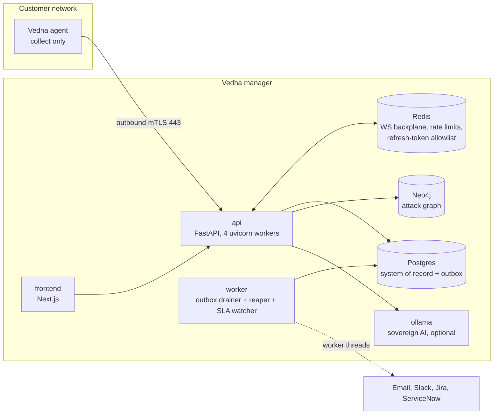

# System design and engineering review

Date: 2026-10-09 · Status: **review — items in §3 are fixed in this change; §4–§6 are open** ·
Scope: the whole platform on `main` after the six-PR consolidation (agent, manager backend,
detection engine, frontend, CI)

## 1. How this review was done

Every finding below was checked against the code, and each one cites the file it lives in.
Nothing here is inferred from a design doc alone. Leads that turned out to be fine are recorded as
strengths (§2) rather than dropped, because knowing what *not* to change is half of a review.

Two lenses:

- **System design**: where state lives, what each component depends on, what happens when a
  dependency is slow or down, and whether the design still holds with more workers, tenants or
  data.
- **Software engineering**: whether CI protects the code, whether tests are trustworthy, how
  errors are handled, and whether the code is shaped so people can change it safely.

Fixes followed one rule: **reproduce the failure, fix it, then prove it**. A test fails on the
old code and passes on the new code, and then the full suites run. §3 records the proof for each.

## 2. Architecture at a glance

The request path (`api`) writes state and an **outbox event in the same transaction**. The
`worker` drains the outbox and does the slow work: detection, notifications, reclaiming stuck
jobs. The agent only ever dials out.

### What is already strong — keep doing this

| Pattern | Where | Why it matters |
|---|---|---|
| Transactional outbox drained with `FOR UPDATE SKIP LOCKED` | `workers/outbox.py:249` | A notification or detection run can never fire for a change that rolled back, or be lost for one that committed. Workers scale with `--scale worker=N` without double-processing. |
| Fencing tokens on result ingestion (`attempt_id` + `fence`) | `services/job_result_service.py:355-393` | A "zombie" agent that reconnects after its job was reassigned gets a terminal *stale* receipt instead of overwriting the new attempt; a retry cannot append duplicate results. |
| Exactly-once SLA alerts via `INSERT … ON CONFLICT DO NOTHING RETURNING` | `workers/sla_watch.py:78-83` | Only the worker whose insert wins announces the alert. This holds across N workers and restarts. |
| Idempotent detection under a per-engagement advisory lock | `workers/outbox.py:133-142`, ADR-0001 | At-least-once delivery cannot produce a phantom second detection run. |
| CPU-bound detection runs in a thread, with the cost measured | `detection/engine_bridge.py:236-246` | 6.5 s for 500 hosts no longer freezes the worker loop. |
| Refresh tokens are an allowlist rotated with atomic `GETDEL` | `auth/refresh_store.py:32-41` | Fails safe: if Redis loses data everyone signs in again; revoked tokens never come back to life. Replay of a used refresh token is detected. |
| Redis backplane for the agent WebSocket | `main.py:106-108` | Real-time job dispatch works with 4 uvicorn workers, whichever one holds the agent's socket. |
| One migration head across 58 revisions | `alembic/versions/` | The four migrations the consolidation brought in chain correctly. |

## 3. Fixed in this change

> **`dev` already had some of these.** Work merged into `dev` on 2026-10-07 to 10-09 fixed #1
> (the same cap), #5 (stamping the platform `VERSION` rather than the agent's), #7 and #8, and
> added a fuller `backend-ci.yml` with an Alembic migrations job (#3). When `test` was merged into
> `dev`, `dev`'s versions were kept. This change added only what `dev` lacked: the detection-engine
> CI job, the `probe/workflow/**` and `probe/scanner/**` triggers (#4), and #2, #6, #9 and #10.

| # | Problem | Root cause | Fix | Proof |
|---|---|---|---|---|
| 1 | Agent overcommits its thread pool on small machines (**real product bug**, surfaced by CI as a "flaky" test) | `_default_host_concurrency` returned `min(8, concurrency)` regardless of CPUs. On a 2-core probe the default thread pool has 6 workers, so 8 hosts queued blocking work behind each other and behind the liveness re-check. | Cap the default by the actual pool size, `min(32, cpus + 4)`. An explicit `PROBE_HOST_CONCURRENCY` still wins. `probe/workflow/workflow_engine.py` | Simulated 2-core run: original code **1 failed** (`8 <= 6`), fixed code **7 passed**. |
| 2 | One slow SMTP server or Slack webhook froze the whole worker | `notify_tenant` is `async` but called blocking senders (`smtplib`, sync `httpx`, 15 s timeouts) directly. The worker runs the outbox drainer, reaper and SLA watcher on **one** event loop, so all three stopped. | Senders run in worker threads, all channels in parallel. Worst case drops from the sum of timeouts with the loop frozen to the slowest single channel with the loop free. `manager/backend/app/services/notifications.py` | New regression test. Old code: **"event loop starved: 0 heartbeats in 1.00 s"**. New code passes. |
| 3 | ~3,000 backend and detection-engine tests ran in **no** CI workflow | No workflow covered `manager/backend` or `manager/detection_engine`. | New `backend-ci.yml`: backend suite and detection-engine suite on every PR touching them. | Locally, with no Postgres or Redis running: backend **2,482 passed**, detection engine **518 passed**. |
| 4 | Agent unit tests skipped changes to the code they test | `agent-ci` path filter covered `probe/agent/**` but not `probe/workflow/**` or `probe/scanner/**`. | Path filter extended. | Bug #1 lived in `probe/workflow/`. |
| 5 | Windows agent `.exe` build failed | Nuitka refuses company/product names without a numeric version. | Version read from the agent's own `VERSION` constant (single source of truth). `probe/windows/build-agent-exe.ps1` | CI log: `FATAL: … file or product version need to be given`. |
| 6 | `seal-parity` killed at its 45-min timeout | The LTO link of 859 C files ran 31+ minutes on 2 cores. | `NUITKA_LTO` build argument (default stays `yes`); parity builds without it. The sealed image is a non-shipping research artifact, and module inclusion is decided before the C link, so the check proves the same thing. | CI log: compile done at 13 min, link still running at 44 min. |
| 7 | `gitleaks` failed on every PR | gitleaks-action v2 requires `GITHUB_TOKEN` on `pull_request`. | Token added with least privilege (`pull-requests: read`, PR comments off). | CI log: `GITHUB_TOKEN is now required to scan pull requests`. |
| 8 | macOS service test failed on Windows | The launchd log path was joined with the host OS separator. | `posixpath`: a plist is a macOS file wherever it is rendered. | CI log: `'/x\\logs\\agent.log' == '/x/logs/agent.log'`. |
| 9 | `No url found for submodule path 'probe copy'` in every job | A folder with its own `.git` had been committed as an orphan gitlink. | Gitlink removed (it pointed at no files in this repo). | — |
| 10 | A Redis outage answered **500** on login (F2) | No handler for Redis unavailability, so it fell through to the catch-all. | Connection and timeout errors answer **503 + `Retry-After: 5`**. Routes stay failed closed; a rejected command (our defect) still answers 500. `manager/backend/app/main.py` | New end-to-end test through the real `/auth/login`: old code **500**, new code **503**. |

## 4. Failure points — system design

Severity combines impact and likelihood. **Critical** means one occurrence is a customer-visible or
regulatory event.

### F1 · Tenant isolation is a convention, not an enforcement — Critical

Tenant *identity* is established centrally and well: `TenantIsolationMiddleware`
(`auth/middleware.py:105`) verifies the token and puts the tenant on `request.state`, so a client
cannot claim another tenant. Tenant *enforcement* is not central. Its own docstring says "all DB
queries downstream use `request.state.tenant_id`", which means **108 hand-written
`tenant_id ==` filters across 27 files**, with **no** Postgres row-level-security policy behind
them. One forgotten filter in a new endpoint shows one bank another bank's findings. For BFSI that
is a reportable incident, not a bug.

**Do:** add Postgres RLS as defense in depth: `SET LOCAL app.tenant_id` at the start of each
request transaction, and a policy on every tenant-owned table. Add a test that walks every route
and asserts it is tenant-scoped. The app-level filters stay; RLS catches the one that is missing.

### F2 · Redis down means nobody can sign in, and it looks like a bug — High

Login calls `check_login_failures(redis, …)` first (`auth/router.py:202`). The rate limiter does
not handle a Redis error (`ratelimit.py:82-92`), and the only exception handler returns a generic
**500 "Internal server error"** (`main.py:229-235`). Token refresh and the agent backplane also
need Redis, and Redis runs with **no volume** (`docker-compose.yml:114-124`), so recreating the
container signs everyone out.

**Done here:** the outage now answers **503 with `Retry-After`** (fix #10), so the on-call
engineer sees "dependency down", not "our code broke". **Still open:** decide fail-open or
fail-closed per route on purpose (fail-closed for login is defensible and is what happens today);
add a Redis volume with AOF, or document that sessions don't survive a redeploy; make readiness
report Redis.

### F3 · One Postgres, no backups, no point-in-time recovery — High

Compose has no backup service and no replica. Recovery point and recovery time are undefined. One
lost disk loses the findings history and the evidence chain of custody. This matches gap P6 in
the privacy approach doc.

**Do:** scheduled `pgBackRest` or `WAL-G` with continuous archiving, and a **restore drill** on a
calendar (a backup never restored is a hope, not a backup). Add a streaming replica in the
enterprise profile.

### F4 · The safety net shares fate with what it watches — Medium

The outbox drainer, the stuck-job reaper and the SLA watcher run in one `asyncio.gather` on one
loop (`workers/outbox.py:484`). Fix #2 removed one way to freeze that loop; the structure still
allows the next one. The agent already learned this lesson ("a heartbeat that needs a worker
thread just queues behind the very scanners it is supposed to be watching").

**Do:** run the reaper as its own process, so a wedged drainer cannot stop the thing that
reclaims its work. Treat "no synchronous I/O inside `async def`" as a review rule. A lint rule
such as ruff's `ASYNC` set can enforce it.

### F5 · A scanner that fails silently reports a clean network — High (for a VA product)

The agent has **70** `except Exception: pass/continue` blocks (the backend has 12). In most
software a swallowed exception is a missing log line. In a vulnerability scanner it is a
**false negative presented as a clean result**. The detection engine already solved this on its
side: rules report *BLIND* verdicts and an ingest census, so a non-finding can explain itself
(`engine_bridge.py:252-264`).

**Do:** carry the same principle into the agent. Every swallowed scanner error becomes a coverage
record ("scanner X errored on host Y") that reaches the report's coverage section.

### F6 · Agent defaults assumed a big machine — Medium

Fix #1 was one fixed constant that broke on a 2-core probe, and customer probes are often small
VMs. **Do:** review the other fixed concurrency and timeout constants against a 2-core,
2 GB machine. Keep a small-host run in CI; this review simulated one by patching the CPU count,
which is cheap to make permanent.

### F7 · Live browser updates are not multi-worker, and that code is unused — Low

`GraphWebSocketManager` / `ConnectionManager` (`websocket/manager.py:27-67, 355`) keeps rooms in
a per-process dict, no route mounts it, and its `broadcast()` iterates a live set across `await`
(a client joining mid-broadcast raises `Set changed size during iteration`).

**Do:** delete it. If live graph updates are wanted, build them on the existing Redis backplane
pattern.

### F8 · No trace across the hops a job makes — Medium

A job crosses agent → API worker → Redis backplane → outbox → detection thread → notification
thread, and there is no shared trace ID (0 OpenTelemetry references). Answering "why is this
finding missing?" means grepping six logs by timestamp.

**Do:** bind a job/trace ID into the `structlog` context at every hop now (cheap); add
OpenTelemetry later.

### F9 · Scaling notes — Low today

- The SLA watcher sweeps every open finding of every tenant every 15 min in one transaction, and
  concurrent workers serialize on its unique index. Fine at thousands of findings. At millions,
  keep an indexed `next_sla_check_at` instead.
- The sealed build is growing (859 C files). Cache compiler output with a BuildKit cache mount
  (`ccache`) and track build time.
- Detection receives facts through a temp JSONL file (`engine_bridge.py:282`): serialize, write,
  parse again on every run. An in-memory entry point would remove that.
- The rate limiter's `INCR` + `EXPIRE` is two round trips and not atomic (recovered by a TTL
  check). A short Lua script makes it one atomic call.

## 5. Findings — software engineering

### E1 · Red CI can merge into `main` — High

PR #9 merged with failing checks because **no check is required**. Fix #3 adds the missing suites;
they only protect `main` once they are required. **Do:** enable branch protection on `main` with
the CI jobs as required status checks.

### E2 · Unit tests that really port-scan a hard-coded address — High (safety)

Four files in the agent's CI list scan real private addresses and rely on them being unreachable:
`test_feasibility.py` (line 189, `10.0.0.1`), `test_run_timing.py` (lines 91-114, `10.0.0.1`),
`test_infeasible_job_admission.py` (lines 49-84, `10.77.0.1`) and
`test_stage_boundary_commits.py` (lines 50-61, `10.99.0.1-2`). Several are full 65,535-port
audits. They pass only because those addresses fail fast on GitHub's runners. On a network that
silently drops the packets, all four hang; this review confirmed that on the original code. On an
office network that uses `10.0.0.0/8`, **running the unit tests port-scans real machines.**

**Do:** inject a fake transport or scanner into these tests. If a real address is unavoidable, use
RFC 5737 TEST-NET (`192.0.2.0/24`) with the connect call mocked.

### E3 · Tests that depend on the runner's CPU count — Medium

The fan-out test passed on 4-core and macOS runners and failed on 2-core ones. It caught a real
bug, which is good, but only by luck of runner size. **Do:** have such tests set the pool size
explicitly (as this review's 2-core simulation did), so they assert the same thing everywhere.

### E4 · Files too large to change safely — Medium

| File | Lines |
|---|---|
| `manager/frontend/app/findings/workspace.tsx` | 4,509 |
| `manager/backend/app/services/report_document.py` | 2,219 |
| `probe/agent/agent.py` | 2,196 |
| `manager/backend/app/routers/agents.py` | 1,836 |
| `manager/backend/app/routers/portal.py` | 1,626 |
| `manager/backend/app/routers/engagements.py` | 1,434 |

Large routers mix HTTP handling with business logic, which makes the logic hard to unit test. This
also showed up as cost: the six-PR consolidation needed three-way merges precisely where these
files were edited in parallel. **Do:** split `workspace.tsx` by panel (list, detail, bulk actions,
filters), and move router logic into `services/`.

### E5 · Exception swallowing is unenforced — Medium

See F5. The codebase already writes `# noqa: BLE001 — reason` where swallowing is deliberate.
**Do:** turn that into an enforced lint rule (ruff `BLE001`, `S110`), so every new swallow needs
a written reason.

### E6 · Repository hygiene — Low

There are 12 stray files at the repository root (`portscan.py`, `promptoutput.md`,
`agressive-plan.md`, `results_by_actual_scripts.md`, …). **Do:** move the docs under `docs/` and
delete scratch files. Platform `VERSION` (1.0.375) and agent `VERSION` (2.0.0) are versioned
separately; document which agent versions a manager accepts.

## 6. Suggested order

| When | Items |
|---|---|
| **Now** | E1 branch protection · F1 RLS design spike · F2 Redis-outage behaviour (503, volume) · F3 backups and a restore drill |
| **Next** | F5 + E5 silent failures become coverage records · E2 hermetic network tests · F4 reaper in its own process · F8 trace IDs |
| **Later** | E4 split the largest files · F6 small-host defaults · F7 delete dead WS code · F9 scaling notes · E6 hygiene |
