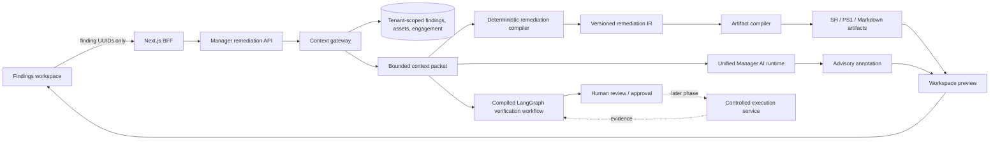

# Vedha AI and Remediation Architecture

Status: implementation baseline for the first safe remediation-workspace slice.

> **Note (2026-09-28):** the implementation this describes lives on branch
> `codex/customer-portal-engagement-parity` and is **not merged into `main`**. Only
> this document was brought over. `main`'s AI routing is described in
> `docs/adr/0004-ai-fallback-chain.md`.

## Outcome

Vedha uses AI to explain, prioritize, and review recorded security evidence. It does not let a probabilistic model silently invent tenant facts or executable remediation bytes. Scripts are compiled from versioned, allowlisted templates; AI advice is a separate, optional annotation.

The first slice is deliberately review-only. It creates downloadable artifacts but never executes them on an endpoint. Approval, durable workspace persistence, deployment orchestration, and post-change verification are later control-plane phases.

## Problems in the previous shape

- AI traffic was split between a multi-provider Manager service and direct Anthropic SDK calls. Features therefore behaved differently and some failed in the default image.
- The LangGraph integration compiled a one-node graph per request and added no routing, durable state, or human decision boundary.
- Generic assistant questions did not carry the operator's selected findings, so prioritization answers were generic.
- Portal finding routes could return the operator schema instead of the customer-safe projection.
- The manager BFF silently dropped two canonical finding filters and mapped several risk signals as if they meant the same thing.
- Remediation knowledge contained a mixture of prose, configuration examples, and shell-like strings. Concatenating that material into a script would be unsafe.
- “Generate and publish” combined content creation and approval. A production approval model needs a content hash, reviewer identity, and immutable audit event.

## Architectural invariants

1. Tenant facts are resolved by Manager from authenticated identifiers. The browser and the model cannot submit authoritative host, finding, or engagement facts.
2. One remediation workspace contains findings from exactly one tenant and one engagement.
3. Executable bytes are deterministic. AI output cannot add, remove, or rewrite an operation in an artifact.
4. A script is scoped to one asset and one operating-system family. Mixed shell dialects are never emitted in one file.
5. Unknown operating systems, missing asset bindings, and unsupported remediations become explicit manual runbook items; they are not guessed.
6. Generated scripts are dry-run/check-first. Mutation requires an explicit apply flag and acknowledgment of the context hash.
7. No artifact downloads code, invokes `eval`, embeds a secret, or performs remote execution.
8. Every generated artifact has a context hash and a content hash. Later approval and execution phases must bind to both.
9. Model input is data, not instructions. Finding titles, evidence, and scanner output are treated as untrusted content.
10. A model outage must not block the deterministic artifact compiler.
11. The generic model-generation endpoint is operator-only. Customer prompts use the dedicated portal route, which resolves their single bound engagement before generation.

## Target architecture



### Context gateway

The context gateway is the authorization and grounding boundary. It accepts up to 20 unique finding UUIDs, joins through the engagement tenant, loads bounded asset metadata, verifies an exact result count, and rejects mixed engagements. It returns a normalized packet rather than ORM objects.

```text
RemediationContext v1
  request: tenant_id, actor_id, finding_ids, requested_at
  engagement: id, name, rules-of-engagement summary
  findings[]:
    id, title, severity, status, category
    cve_ids, cvss, epss, KEV, exploit-validation
    verification state and bounded evidence summary
    recorded remediation guidance
    asset: id, stable display name, OS family/version, criticality, environment
  constraints:
    max findings, review-only, remote execution forbidden, secrets forbidden
  context_sha256
```

Raw scanner output should not be sent to a model by default. The packet includes bounded evidence summaries and explicit “not recorded” values so missing data is not interpreted as a negative result.

### Remediation workspace deep module

The `RemediationWorkspace` module owns the difficult invariants behind one narrow operation:

```text
build(context) -> WorkspacePreview
```

Callers do not choose shell quoting, template matching, hashes, filenames, grouping, or safety warnings. They supply authorized normalized context and receive immutable artifact values.

The internal remediation IR is versioned and typed:

```text
RemediationOperation v1
  template_id, template_version
  kind: command | manual
  platform: windows | linux | macos | generic
  check, apply, verify, rollback
  privilege, risk, reboot_required
  finding_ids, asset_id
```

Knowledge-base prose can inform a manual runbook, but it is not executable IR. Only reviewed templates may produce command operations.

### Artifact contract

Each output contains:

- an asset/OS-specific filename;
- the selected finding IDs and context SHA-256;
- a content SHA-256 calculated over the exact returned bytes;
- check, apply, verification, and rollback guidance where supported;
- warnings and manual blockers;
- no secret values.

Shell artifacts default to check mode and accept `--check`, `--dry-run`, or `--apply --ack-context <context-sha256>`. PowerShell artifacts default to `-Mode Check` and accept `-Mode DryRun` or `-Mode Apply -AckContext <context-sha256>`. Unsupported changes are emitted as Markdown instead of being disguised as safe automation.

### Unified AI runtime

All report, assistant, remediation-advisory, and verification narration paths use `ManagerLlmService`. Provider selection, timeouts, error normalization, privacy classification, and fallback policy live in that service.

AI responses are allowed to:

- explain evidence and uncertainty;
- prioritize an exact selected set;
- group common remediation themes;
- identify missing validation evidence;
- summarize deterministic artifacts and their operational risks;
- draft a human-readable report.

AI responses are not allowed to:

- establish tenant scope;
- declare a finding verified without recorded evidence;
- generate executable artifact bytes;
- approve or deploy a change;
- invent package versions, CVEs, hosts, or successful validation.

### LangGraph boundary

LangGraph is useful for stateful, conditional security workflows—not as a wrapper around a deterministic function.

The verification graph is compiled once per process and uses typed state. Its useful nodes are:

1. normalize recorded evidence;
2. calculate a deterministic baseline verdict;
3. optionally request a model review for ambiguous evidence;
4. validate the model review against allowed verdicts and confidence movement;
5. route high-impact or conflicting results to human review;
6. emit the final recorded decision packet.

Durable interruption/checkpointing belongs in the later approval workflow. It requires a persistent checkpointer and a stable thread identifier tied to the remediation workspace. Artifact compilation itself remains a normal pure module and never depends on graph execution.

## Where AI should be added

| Area | Useful AI role | Required guardrail |
|---|---|---|
| Finding triage | Explain prioritization across an exact selection | Server-resolved context; show recorded signals separately |
| Evidence review | Summarize conflicting scanner evidence | Deterministic baseline; human review on disagreement |
| Remediation | Explain a compiled plan and rollout risks | AI cannot mutate executable bytes |
| Reports | Draft audience-specific narrative | Canonical report document remains source of truth |
| Detection engineering | Propose candidate rules and missing telemetry | Offline tests and analyst approval before enablement |
| Attack-path analysis | Explain graph paths and likely choke points | Paths must be computed from recorded graph edges |
| Change verification | Interpret before/after evidence | Re-scan evidence and deterministic pass criteria |
| Case clustering | Suggest duplicate/root-cause groups | Reversible suggestion; preserve original findings |

## Where AI should not be added

- tenant authorization and row filtering;
- risk-score arithmetic and SLA clocks;
- shell escaping or script assembly;
- approval enforcement;
- agent job dispatch;
- secrets handling;
- immutable audit logging;
- lifecycle state transitions without explicit deterministic rules.

## Delivery phases

### Phase 1 — safe preview

- fix portal projection and manager mapping/filter defects;
- unify model transport;
- compile a typed conditional verification graph once;
- allow up to 20 selected findings;
- hydrate authoritative context on the server;
- generate per-asset/OS deterministic SH, PS1, or Markdown artifacts;
- provide optional advisory text separately;
- download files locally; never execute them.

### Phase 2 — immutable review workspace

- persist workspace, context hash, artifact hashes, template versions, and creator;
- split generate, review, approve, and revoke permissions;
- invalidate approval when content or context changes;
- add reviewer comments and signed download audit events;
- use an outbox for advisory generation instead of in-process background tasks.

### Phase 3 — controlled execution and verification

- explicit deployment targets and maintenance windows;
- short-lived credentials from a secrets broker, never from model context;
- canary and concurrency limits;
- pre-check, apply, post-check, rollback, and evidence capture;
- durable LangGraph interrupt for human approval;
- automatically open a verification task, never automatically close a finding solely from model output.

## Evaluation and operations

Track these separately so a fluent response cannot hide a broken system:

- context accuracy: requested IDs equal resolved IDs and all share tenant/engagement;
- grounding: unsupported factual claims per response;
- deterministic equivalence: same context and template version produce identical bytes;
- artifact safety: forbidden-token, secret, remote-execution, and mixed-dialect tests;
- provider reliability: latency, timeout, fallback, and failure by task/provider/model;
- graph quality: baseline/model disagreement, human override, and calibration by verdict;
- remediation outcome: check/apply/post-check result, rollback rate, and recurrence after re-scan.

Never log full prompts, raw evidence, secrets, or generated script content. Log stable IDs, hashes, sizes, provider/model identifiers, duration, outcome, and error class.

## Decision record

The chosen design optimizes for a deep, testable remediation boundary. An alternative “AI writes a script and a regex filters it” design was rejected because regex cannot establish command semantics, context prerequisites, rollback safety, or tenant correctness. An alternative “put every step in LangGraph” design was rejected because it obscures a deterministic compiler behind orchestration machinery without adding a legitimate state transition.
