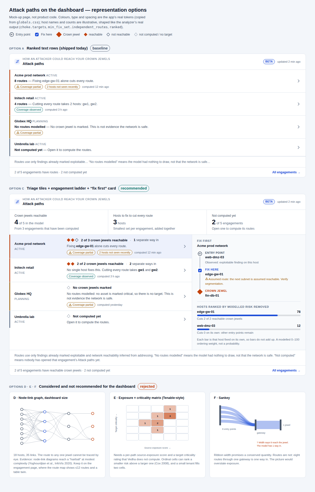
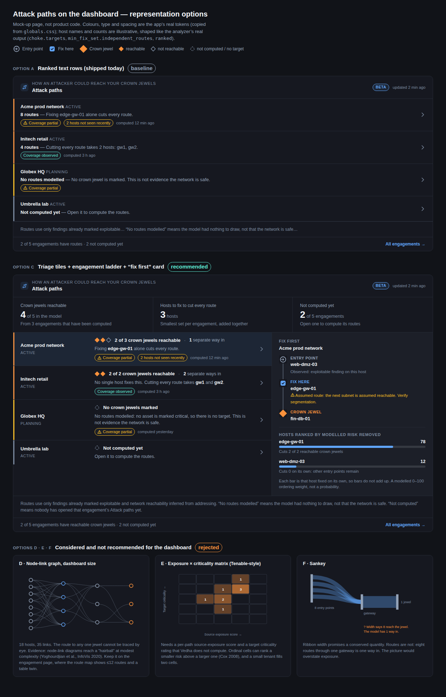
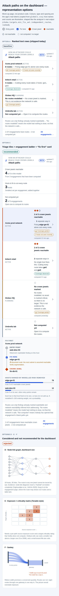

# Attack paths on the dashboard: how to represent them (research, review and plan v2, 2026-10-09)

**Status:** v2. Phases 0 to 2 are being built from this version. Version 1 of this plan was reviewed
against the code the same day; section 4 lists what was wrong with it and what changed. The first dashboard
section it follows shipped on `claude/elegant-noether-ggdafj` (commits `27b80255`, `3a921fce`, `7df368c6`).

## 0. The decision in ten lines

1. **Do not put a graph on the dashboard.** The products I could find summarise attack paths with
   counts and ranked lists (Microsoft and Tenable add change over time) and keep the graph in a drill-down.
   A graph at dashboard size is unreadable at 18 hosts (mock-up below).
2. **Lead with reachability, not "N routes".** The route count I shipped is the length of a *capped* list
   (at most 5 routes per entry point per crown jewel), so it measures the search limit as much as the network.
3. **Review of v1 found 16 failures** (section 4). The most serious is already shipped: **when a crown jewel is
   itself exposed to the internet, the dashboard and the engagement page say "Fixing gw alone cuts every
   route", and when it is the only exposed host they say "No routes modelled"**, although the analyzer scores
   that jewel at the maximum. Phase 0 fixes both.
4. **Tiles now count engagements, not assets.** v1 added crown jewels and hosts across different networks,
   which is not a meaningful number and can double count. Per-network counts live on each row.
5. **Rows have six honest states** (exposed, reachable, unreachable, no crown jewel marked, not computed,
   unrecorded) instead of three, so "nothing to assess" never reads as "0 reachable".
6. **The overview is computed on the server across all engagements, then limited.** v1 limited first (ordering
   by the capped count) and loaded every analysis in full.
7. **The "Fix first" card gets its own read-only endpoint.** v1 reused the path-list endpoint, which *writes on
   a GET* for any engagement with no stored routes.
8. **Bars show the share of modelled risk removed** (bounded, already used on the engagement page), not a
   "0 to 100" number that can exceed 100.
9. **Zero new libraries**; history and trend stay in Phase 3, behind your decision.
10. **Eight decisions are yours** (section 9). Phases 0 to 2 need none of them.



*v1 mock-up (not product code; real design tokens, illustrative names). Section 5 lists what v2 changes in it:
the tiles, the row states and the card wording. Screenshots of the real build are in the appendix.*

---

## 1. What the section has to do

The operator on this dashboard runs several engagements. In a few seconds they need to answer:

| # | Question | Where the answer comes from |
| --- | --- | --- |
| 1 | Can an attacker reach a crown jewel? How many of them? Is one exposed outright? | `choke.targets[]`: `best_likelihood > 0`, and `exposed_directly` |
| 2 | How many separate ways in? (one fix, or several?) | `choke.min_fix_set.independent_routes` (vertex-disjoint, by Menger's theorem) |
| 3 | What do I do first? | `choke.min_fix_set.assets`, `choke.ranked` |
| 4 | Can I trust this? | `coverage.confidence`, `freshness.stale_assets`, `computed_at`, "not computed yet" |
| 5 | Is it getting better? | **not stored today** (Phase 3) |
| 6 | Where do I go next? | link to `/engagements/{id}/attack-paths` |

The layout rule on this dashboard (`DashboardGrid.tsx`) is that nothing below the first tier competes
with it: no display numerals above 26 px, no colour outside severity and state. Stephen Few's
definition fits: a dashboard is read in brief glances and fails if it cannot say what matters in an
instant ([summary](https://www.theinformationlab.co.uk/community/blog/information-dashboard-design-stephen)).

## 2. What I found

### 2.1 In our own data: the headline number I shipped is the weak one

Read from `analyzer.py` and `routers/attack_paths.py`:

| What the dashboard shows now | What it really is | Better number already stored |
| --- | --- | --- |
| "8 routes" (`path_count`) | `len()` of a list capped at `max_paths_per_source=5` per entry point per crown jewel (`find_paths_to_target`). Grows with entry points, not with exposure | `min_fix_set.size`, `independent_routes` |
| "N crown jewels" (`len(choke.targets)`) | Jewels *considered*, reachable or not | `targets[].best_likelihood > 0` = reachable |
| "N entry points" (`choke.entry_points`) | Internet-exposed hosts *considered* | not stored per reachable jewel |

Measured on the repo's own validation fixtures (real analyzer output):

| Fixture | Stored route count | What matters |
| --- | --- | --- |
| `09` eight exposed hosts, one gateway | **8** | one fix (`gw`) cuts everything |
| `08` two independent routes | **4** | only 2 separate ways in; no single host fixes it (`ranked` is empty) |
| `01` flat internal network | **1** | one fix (`entry`) |

The count tracks the number of entry points, not how hard the crown jewel is to protect: `09` reads as
twice `08` although `08` needs more fixes. Sorting engagements by it would mislead. So the plan demotes the route count (it stays on the engagement page, labelled as a capped
list) and leads with reachability, independent routes and the fix set.

Also not stored: any history. `attack_path_analyses` holds one row per engagement, replaced on every
recompute, so no trend or "since last scan" can be shown yet.

### 2.2 How other products summarise attack paths

I could not open vendor pages from this environment (outbound fetches are blocked, only search
summaries came back), so this table is from search-result summaries. Check the linked pages before
quoting any of it.

| Product | What its summary view shows | Graph? | Source |
| --- | --- | --- | --- |
| Microsoft Exposure Management | A chart of attack paths **over time**, top choke points, top attack-path scenarios, top targets, top entry points; choke-point side panel with "View blast radius" | Drill-down | [docs](https://learn.microsoft.com/en-us/security-exposure-management/review-attack-paths) |
| Tenable One, Attack Path Analysis | Counts (vulnerable critical assets, attack paths), open findings by severity, a **matrix** (source-node exposure score × target criticality), a trending list, a "compare to" baseline with direction arrows | Drill-down | [docs](https://docs.tenable.com/tenableone/attack-path-analysis/Content/AttackPath/AttackPathDashboard.htm) |
| XM Cyber | Security score, choke points by severity, critical assets by severity, top compromising exposures (this from a third-party integration listing) | Separate view | [listing](https://cortex.marketplace.pan.dev/marketplace/details/XMCyber), [review](https://www.scworld.com/news/xm-cyber-1-35) |
| Wiz | Issues prioritised by impact; the full path in a graph view | Graph on the issue | [Wiz academy](https://www.wiz.io/academy/attack-path-analysis) |
| Horizon3 NodeZero | Paths ranked by impact, step-by-step summary per path, one-click check that a fix worked | Per path | [Horizon3](https://horizon3.ai/using-nodezero-to-uncover-the-paths-attackers-take-before-they-do) |

Pattern across all five: **summary = counts + ranked lists + change over time; graph = drill-down.**
Two things worth borrowing: a *trend/compare* element (Microsoft, Tenable), and *verification of a fix*
(Horizon3), which our "recompute after detection" already enables once history exists.
XM Cyber and Cyentia's research that only about 2% of exposures sit on choke points
([Cyentia](https://www.cyentia.com/value-of-choke-points/), vendor-sourced) supports giving the "fix first"
element as much visual weight as the exposure number.

### 2.3 What research says about the forms

- **Node-link graphs stop working at modest complexity.** Even the best layouts end as "hairballs";
  the remedy is aggregation or filtering ([Yoghourdjian et al., InfoVis 2020](https://vcg.seas.harvard.edu/publications/20201001-scalability-of-network-visualisation-from-a-cognitive-load-perspective)).
  For *path-finding* tasks, node-link beats matrices in the comparisons I found, though the studies
  disagree about large graphs ([Okoe et al., TVCG 2018](https://smsf.cs.arizona.edu/~kobourov/NL-AM-TVCG18.pdf),
  [layered-graph study, 2025](https://arxiv.org/pdf/2507.10883)). So: node-link is right for *one route*
  on the engagement page, wrong for a dashboard overview.
- **Attack-graph literature's fix is aggregation.** Group hosts into protection domains and show the
  domains ([Noel & Jajodia, ACSAC 2005](https://acsac.org/2005/abstracts/87.html),
  [aggregation framework](https://patents.google.com/patent/US7627900),
  [Homer et al., VizSEC 2008](https://www.cs.ksu.edu/~xou/publications/vizsec08.pdf)). Vedha already has
  subnet "hub" nodes, so a zone-level view is feasible later (Phase 5, optional).
- **Sankey diagrams promise a conserved quantity** (flow in equals flow out) and are hard to read for
  exact values ([guide](https://www.storytellingwithdata.com/blog/what-is-a-sankey-diagram)). Attack
  routes are not a conserved flow: eight routes through one gateway are one way in. A Sankey would
  overstate exposure. Rejected.
- **Risk matrices** can rank a smaller risk above a larger one and, with negatively correlated axes,
  do worse than random (Cox 2008, as summarised in a [2021 follow-up](https://arxiv.org/pdf/2103.05440)). Tenable's matrix
  also needs two per-path scores Vedha does not compute. Rejected.
- **Gauges use a lot of space to show only "now"**; Few designed the bullet graph to replace them
  ([summary](https://www.theinformationlab.co.uk/community/blog/information-dashboard-design-stephen)).
  The reachable-jewel meter below is a small count meter in that spirit, not a dial.

### 2.4 Technology, measured here

Bundle cost of each candidate, measured in this environment (esbuild, minified, `gzip -9`, React external).
The figures in web summaries disagreed with each other (for example 25 KB versus 113 KB for sigma), so
these are measured, not quoted.

| Candidate | gzip | Verdict |
| --- | --- | --- |
| d3-sankey | 2.8 KB | cheap, but wrong form (2.3) |
| dagre (`@dagrejs/dagre`) | 16.8 KB | a layered layout we do not need: roles give the columns |
| `@xyflow/react` (React Flow) | 59.3 KB | built for editable node editors; no layout engine included |
| Recharts `Sankey` | 74.6 KB | recharts is already loaded on the dashboard (`DashboardCharts`); wrong form |
| sigma + graphology | 112.8 KB | WebGL, for very large graphs; opaque to screen readers |
| cytoscape | 141.5 KB | analysis toolkit; heavy |
| elkjs (bundled) | 440.1 KB | nested/orthogonal routing; far beyond need |

**Conclusion: hand-rolled HTML/CSS plus a few inline SVG glyphs, 0 KB added.** The existing route map
on the engagement page is already hand-rolled SVG with its own layout function, so this matches the code
base. A sparkline (Phase 3) is one `<polyline>`.

### 2.5 Accessibility, checked against the app's own tokens

Contrast computed for the tokens a redesign would use, on `--bg-panel` and `--bg-surface`, both themes
(the lowest figure is shown):

| Token group | Lowest ratio | Needed | Result |
| --- | --- | --- | --- |
| `--text-primary`, `-secondary`, `-muted`, `-faint` | 4.55 | 4.5 (text) | pass |
| `--accent`, `--sev-critical/high/medium/low`, `--nominal` | 4.59 | 4.5 (text), 3 (graphics) | pass |
| **`--border-default`** | **1.45** | 3 (graphics that carry meaning) | **fail** |
| **`--border-strong`** | **2.07** | 3 | **fail** |

Consequences: marks that carry meaning (connectors, hollow shapes, meter outlines) use `--text-muted`
or stronger, never a border token. **Existing defect:** `.ap-edge { stroke: var(--border-strong) }` in
`app/engagements/[id]/attack-paths/styles.ts` draws the route-map edges at 2.68:1 (light) and 2.22:1
(dark). Role is already stated in words on every node, but which node connects to which is carried by
those edges. Fixed in Phase 0.

Other rules the design follows (from the data-viz guidance the repo's dashboard already uses): colour is
never the only channel (each role has a shape and a word), every chart has a text twin (the list), status
colours are reserved for state, no dual axes, marks are thin with 2 px gaps.

### 2.6 Limits of this research

- Vendor pages could not be opened; section 2.2 rests on search summaries.
- No user test: nobody has looked at this on a real engagement. The mock-up uses invented host names.
- The studies on node-link versus matrix disagree; I rely on them only for the narrow claim "a graph
  stops being readable as it grows", which they all support.
- Phase 0's numbers depend on the model's existing limits: only findings already marked exploitable
  create steps, targets are the assets marked critical, and reachability between subnets is inferred.
  P2, P3 and P4b remain unbuilt, so "0 reachable" never means "safe".

---

## 3. Options considered

| | Form | Answers Q1–Q6 | Honest? | Cost | Verdict |
| --- | --- | --- | --- | --- | --- |
| A | Ranked text rows (shipped) | 1, 3, 4, 6 partly; headline is the weak number | mostly | done | baseline: fix the numbers, add scan-ability |
| B | Tiles + rows with meters | 1–4, 6 | yes | S–M | the base of C |
| **C** | **B + "Fix first" card (route chain + ranked hosts)** | **1–4, 6 (5 in Phase 3)** | **yes** | **M** | **recommended** |
| D | Mini node-link graph | 6 only; unreadable beyond ~12 hosts | yes | M + a layout lib | rejected for the dashboard; keep on engagement page |
| E | Exposure × criticality matrix | needs scores we do not have | ordinal cells mislead | M | rejected |
| F | Sankey | implies conserved flow | **no** | S–M | rejected |
| G | Trend sparkline / change arrow | 5 | yes, with caveats (2.7) | M, needs a table | Phase 3 |
| H | Zone-level aggregated map | 3, 6; the literature's answer to hairballs | yes | L | optional Phase 5, engagement page |
| I | Item in "Needs attention now" | 3 | yes if neutral wording | S | decision D3 |

## 4. Review of plan v1: what was wrong

Each item was checked against the code or by running the analyzer on the repo's validation fixtures
(`manager/backend/tests/fixtures/attack_paths`). Severity: **High** = a wrong statement reaches the operator,
**Medium** = a wrong or unbounded aggregate or a performance risk, **Low** = polish.

| # | Sev | Area | What was wrong | Evidence | v2 resolution |
| --- | --- | --- | --- | --- | --- |
| R1 | **High, shipped** | Honesty | A crown jewel that is itself exposed and exploitable is counted as a *source*, so the analyzer scores it 100 (`best_likelihood 1.0`) but excludes it from the fix set. The dashboard and engagement page then say "Fixing `gw` alone cuts every route" (false: the jewel is exposed regardless) | Fixture `09` with the jewel also exposed: `risk 100`, `ranked []`, `min_fix_set {size 1, [gw]}`, 8 stored routes | Analyzer records `exposed_directly` per crown jewel; fix sentence and "ways in" are replaced by "a crown jewel is itself exposed; remove that exposure first" |
| R2 | **High, shipped** | Honesty | When the jewel is the *only* exposed host there are 0 stored routes, so the dashboard row reads "No routes modelled ... not evidence the network is safe" for the worst case there is | Same fixture, only the jewel exposed: `path_count 0`, `best_likelihood 1.0`, `reasons []`, `min_fix_set size 0` | New `exposed` state, ranked first, red rail, own wording |
| R3 | Medium | Design | Tiles summed jewels and hosts across engagements. Different networks (often different customers) do not add, and two engagements over the same network double count | Design review of 4.2 in v1 | Tiles count **engagements**; per-network numbers stay on the row |
| R4 | Medium | Design | Engagements with no crown jewel marked were counted as "computed", so they inflated the denominator of "reachable" | v1 tile 1 | `no_targets` is its own state and is excluded from "assessed" |
| R5 | Medium | API | The overview orders by the capped `path_count` **in SQL, then applies the limit**; any new ranking is applied after engagements were already dropped | `ORDER BY path_count DESC ... LIMIT` in `attack_paths_overview` | Light rows for all of the tenant's engagements (capped at 1000), rank in Python, then slice |
| R6 | Medium | API / perf | The overview loads each engagement's whole `analysis` JSON (coverage segments, 20 ranked hosts, diagnostics) every 120 s | `select(... AttackPathAnalysis.analysis)` | Project only the sub-keys the row needs (`#>` paths in SQL) |
| R7 | Medium | API | Tile totals computed from the visible rows would be wrong whenever `total > limit` | Dashboard requests a slice | `summary` computed on the server over all rows |
| R8 | **High (in v1's plan)** | Safety | v1's card called `GET /engagements/{id}/attack-paths`, which **recomputes and writes** when no route rows are stored (`refresh or stored is None`). That is every computed-empty or exposed-only engagement, on every dashboard load | `list_attack_paths` | Dedicated read-only `GET /attack-paths/focus/{id}`; a test proves it never calls the recompute path and issues no write |
| R9 | Medium | Honesty | v1 labelled risk bars "0 to 100". `risk_removed` is `100 × Σ impact × Δlikelihood` over crown jewels, so it is **not bounded by 100** (the type comment in `attack-paths.ts` is wrong too) | `choke_analysis`; fixture `09` with 3 jewels gives 36.45 where each jewel alone is 12.15 | Bars use the existing bounded `riskShare` (share of the engagement's modelled risk); the comment is corrected |
| R10 | Medium | Honesty | The chain tagged the second node "Fix here" by position. The best host to fix is not necessarily on the highest-risk route | `fixPointIds` already exists for the map | Tag a node only if it is in `fixPointIds`; if none is, say "none of this route's hosts is on the fix list" |
| R11 | Low | Honesty | Card text asserted a reason the data does not hold ("other entry points remain") | v1 mock-up | Neutral wording: "Cuts off 0 of 2 crown jewels on its own" |
| R12 | Medium | Honesty | Older stored analyses may lack per-jewel fields; treating a missing value as 0 would read as "unreachable" | v1 did not handle it | `unrecorded` state; counts are `null`, never 0 |
| R13 | Low | UX | A route can have up to 10 hops, so the chain card could grow very tall | `max_hops=10` in the analyzer | Show at most 5 nodes; collapse the middle into "+N more hosts" but never hide a fix-list host |
| R14 | Low | Layout | Breakpoints were by viewport. The 216 px sidebar (plus page padding) means the panel is narrower than the viewport, so the two-column layout would break too late | Layout shell | Container query on the panel's own width |
| R15 | Low | Process | A "visual baselines in `test:visual`" step cannot run (no CI, needs seeded data) and would be flaky | CI state | Dropped; scripted browser checks plus committed screenshots instead |
| R16 | Low | Product | Completed or paused engagements rank like active ones and add noise | `EngagementStatus` has `completed`, `paused` | Status is shown on each row; filtering is decision D7 |

**Reviewed and fine:** tenant scoping (every query filters `Engagement.tenant_id`), operator-only role gating,
customer-portal exclusion (the portal source has no such dataset), escaping of host and engagement names
(rendered as React text), refetch behaviour (previous data kept), and that additive API fields keep older
clients working.

**Known limitations that remain after v2** (said on screen, not hidden):
- "Reachable" includes routes that rest on **assumed** links between subnets. The route card shows the basis of
  each hop; the tiles say "in the model".
- Only findings already marked exploitable create attacker steps; P2, P3 and P4b are not built. A scan-only
  engagement can show few routes without being safe.
- No history yet (Phase 3), so no "is it getting better?".

---

## 5. Design v2

### 5.1 What changed from the v1 mock-up

| Part | v1 | v2 |
| --- | --- | --- |
| Tile 1 | "Crown jewels reachable 4 of 5" (sum over engagements) | "Engagements with a reachable crown jewel: X of N assessed"; below it, "directly exposed" count if any, else jewels reachable across them |
| Tile 2 | "Hosts to fix 3" (sum) | "Cut by fixing one host: K of X" (engagements where a single host cuts every route) |
| Tile 3 | "Not computed yet" | "Can't be assessed yet": not computed + no crown jewel marked + unrecorded, with the parts below |
| Row states | routes / empty / not computed | **exposed**, reachable, unreachable, no crown jewel marked, unrecorded, not computed |
| Fix sentence | from `min_fix_set` only | suppressed and replaced when a jewel is itself exposed |
| Card | chain by position, 0–100 bars, three existing endpoints | chain tagged by `fixPointIds`, share bars, one read-only endpoint |

### 5.2 Anatomy

```
Panel "Attack paths"                         [Beta]  updated 2 min ago     (container: min 760 px = two columns)
┌ tile ─────────────────────────┬ tile ───────────────────────┬ tile ───────────────────────┐
│ Engagements with a reachable  │ Cut by fixing one host      │ Can't be assessed yet       │
│ crown jewel                   │                             │                             │
│ 2 of 3 assessed               │ 1 of 2                      │ 2                           │
│ 1 has a jewel directly exposed│ The rest need several fixes │ 1 not computed · 1 no jewel │
└───────────────────────────────┴─────────────────────────────┴─────────────────────────────┘
┌ engagement ladder (top 5) ─────────────────────┬ Fix first · <top engagement> ─────────────┐
│ ▍Acme  ◆◆◇ 2 of 3 crown jewels reachable       │ ① ENTRY POINT   web-dmz-03                │
│        1 separate way in · Fixing edge-gw-01   │   │ Observed                              │
│        alone cuts every route.                 │ ② ON THE FIX LIST edge-gw-01              │
│ ▍Initech ◆◆ 2 of 2 · 2 separate ways in        │   │ Assumed route (verify segmentation)   │
│        No single host fixes this: gw1, gw2     │ ③ CROWN JEWEL   fin-db-01                 │
│ ▍Hooli ◆ Directly exposed (listed first)       │ Share of modelled risk removed            │
│ ▍Globex ◇ No crown jewels marked               │ edge-gw-01 ████████░ 82%  cuts off 2 of 2 │
│ ▍Umbrella ◇ Not computed yet                   │ Each bar is that host alone; do not add.  │
└────────────────────────────────────────────────┴───────────────────────────────────────────┘
 footnote                                                              All engagements →
```

### 5.3 Row states (server-side `state`, one claim each)

| State | Rule | Rail | Headline | Notes |
| --- | --- | --- | --- | --- |
| `exposed` | ≥1 crown jewel with `exposed_directly` | critical | "N crown jewel(s) directly exposed" | "Fixing hosts on the way in does not protect it. Remove its exposure first." Fix set and "ways in" are not shown |
| `reachable` | ≥1 jewel reachable, none exposed | high | "X of Y crown jewels reachable" | meter, "N separate ways in", fix sentence, coverage chips |
| `unreachable` | jewels marked, none reachable | medium | "No modelled route reaches a crown jewel" | first recorded reason, "not evidence the network is safe" |
| `no_targets` | computed, no crown jewel in the model | medium | "No crown jewels marked" | "Mark the assets that matter so routes to them can be modelled" |
| `unrecorded` | computed, per-jewel data missing | neutral | "Computed; per-jewel detail not recorded" | "Open it to refresh"; counts are `null`, not 0 |
| `not_computed` | no stored analysis | faint | "Not computed yet" | "Open it to compute the routes" |

Order: `exposed`, `reachable` (more reachable jewels first, then higher modelled top risk), `unreachable`,
`unrecorded`, `no_targets`, `not_computed`; ties by name.

### 5.4 Elements, data and rules

| Element | Data | Rule |
| --- | --- | --- |
| Tiles | `summary` from the server, over **all** engagements | counts of engagements only; when nothing is assessed tile 1 shows "—" and "Nothing computed yet", never "0 of 0" |
| Jewel meter | `jewels_total`, `jewels_reachable` | one diamond per crown jewel (max 8, then "+N"): filled = reachable, hollow = not, dashed = no target / not computed; `aria-hidden`, the words beside it carry the meaning |
| "N separate ways in" | max of `independent_routes` over reachable jewels | wording is "separate ways in", never "routes"; not shown for `exposed` |
| Fix sentence | `min_fix_set` | one host: "Fixing X alone cuts every route."; several: "No single host fixes this: cutting every route takes K hosts: a, b, +N more."; none found: "The analysis found no host whose fix cuts these routes." |
| Chips | coverage, stale hosts, computed time | unchanged; coverage is "partial" or "observed", never "complete" |
| Route chain | `focus.route` | roles by shape and word; `ON THE FIX LIST` only for hosts in `fixPointIds`; basis of each hop in words; ordered list; ≤5 nodes shown |
| Bars | `focus.ranked[].share` | bounded share of modelled risk; one bar per host; never stacked or summed |

### 5.5 Where it sits, states, responsive, accessibility

- Own band under posture and SLA (unchanged); an item in "Needs attention now" is decision D3.
- Loading shows the final shape; a failed load shows an error with Retry; "No engagements yet" is its own state.
  A failed **focus** request degrades to the row text only, never blanks the ladder.
- Layout: the panel is a size container; two columns at 760 px of panel width, one below. Rows collapse to name
  above facts under ~560 px (the v1 mock-up showed the fixed name column crushed the facts at 420 px).
- Colour is never the only channel; connectors and outlines use `--text-muted` or stronger (3:1), never border
  tokens (section 2.5); text sizes come from the type scale tokens.
- Rows are links; the chain is an `<ol>`; the bars are a list with text values; the meter is decorative.

---

## 6. Data and API changes

| Change | Where | Notes |
| --- | --- | --- |
| `exposed_directly` per crown jewel | `analyzer.choke_analysis` | `true` when the jewel is itself an exploitable internet-exposed host. Older stored analyses lack it: the reader falls back to `best_likelihood ≥ 0.9999`, which is exact because any route multiplies at least one step probability below 1 (the highest step value is 0.95) |
| Overview v2 | `app/graph/overview.py`, `routers/attack_paths.py` | additive fields `state`, `jewels_total`, `jewels_reachable`, `jewels_exposed`, `ways_in`, `top_risk`; the old fields stay. New top-level `summary`. Light query (sub-keys only), all tenant engagements (cap 1000), rank, then slice |
| Focus endpoint | `GET /attack-paths/focus/{engagement_id}` | read-only (never reaches `_recompute_and_store`), operators only, tenant-scoped. Returns `state`, `exposed` jewels, the highest-risk stored route (nodes with role and `on_fix_list`, hops with basis), the fix set and the top 3 hosts with `share` and jewels cut off |
| BFF | `app/api/attack-paths/focus/[id]/route.ts` | UUID-validated like the others |
| View-model | `lib/attack-paths.ts` | `overviewState`, `overviewLine`, `overviewTiles`, `meterCells`, `routeChainView`, `focusBars`; `fixFirstSummary` handles the exposed case on the engagement page too |
| Contrast | route-map CSS | edge token `--border-strong` → `--text-muted`; a test parses the real tokens and asserts 3:1 in both themes |
| History | migration `0061` | Phase 3 only |

---

## 7. Phases (v2)

Each phase ships with tests and keeps `tsc`, `eslint`, backend, detection-engine and frontend suites green.
None adds a dependency.

### Phase 0 — make the numbers true (M)
1. Analyzer: `exposed_directly` per target; tests from fixture `09` variants (jewel exposed together with
   entries; jewel the only exposed host).
2. `overview.py`: `build_row` v2 (six states, per-jewel counts, `ways_in`, `top_risk`, unknown = `None`),
   `build_summary`, new ordering. `routers/attack_paths.py`: light projected query for all tenant engagements,
   rank, slice, `summary`.
3. Frontend view-model: new states and wording; `fixFirstSummary` exposed case; `riskShare` comment fixed.
4. Route-map edge colour and the token-contrast test; type-scale tokens in the overview styles.
5. Existing tests updated to the new wording.
**Done when:** fixtures `09`/`08`/exposed-jewel produce "1 host", "no single host … 2 separate ways in" and
"directly exposed"; an exposed-only engagement is never "No routes modelled"; a tenant with more engagements
than the limit still ranks and totals correctly.

### Phase 1 — tiles and ladder (M)
`AttackPathsTiles`, `JewelMeter`, rebuilt `OverviewList` rows, container-query layout, skeleton parity, the
`/attack-paths` page reuses them. **Done when:** every state in 5.3 renders in light, dark, narrow; no
horizontal scroll; keyboard focus visible; honesty tests pass.

### Phase 2 — "Fix first" card (M)
`GET /attack-paths/focus/{id}` + BFF + `FixFirstCard` (`RouteChain`, `RiskBars`). **Done when:** a test proves
the endpoint never recomputes or writes; exposed and no-route cases render without a chain; long routes
collapse but keep fix-list hosts; a failed focus request leaves the ladder intact.

### Phase 3 — history and trend (M, decision D4)
Unchanged from v1: migration `0061_attack_path_snapshots`, retention (7 days full, then daily, cap 90), a
sparkline per row, "changed since last scan" wording (never better/worse: more scanning can raise the count).

### Phase 4 — surfacing (S, decisions D3 and D5)
Optional "Needs attention now" item; optional "Compute" for not-computed rows.

### Phase 5 — zone view on the engagement page (L, optional)
Aggregate hosts into subnets and show the route as zones (the aggregation the literature recommends).

---

## 8. Verification plan

- **Unit:** every row state; ordering; summary arithmetic; tile wording incl. "—"; fix-sentence cases (one host,
  several, none found, exposed); chain collapse; share bars bounded; escaping of names; token contrast.
- **Backend:** real-fixture tests (09, 08, exposed variants); scripted-DB handler tests; read-only SQL assertion
  for both endpoints; role gating; tenant scoping; over-limit ranking test.
- **Live stack:** Postgres 16 with seeded engagements in each state, API and `next dev`; browser checks
  (dashboard, `/attack-paths`, portal does not show it, error and empty states, dark, narrow, with the real
  sidebar at 1280 and 1024 px, keyboard path, no horizontal scroll); the JSON-path query is exercised on real
  Postgres, not only on a fake.
- **Budget:** 0 KB added; the overview issues a bounded number of queries; the focus request runs for one
  engagement only and only when its state is `exposed` or `reachable`.
- **Not claimed:** that it reads right on real engagement data. That needs you to open it on a real engagement.

## 9. Decisions for you

| # | Decision | Recommendation |
| --- | --- | --- |
| D1 | Headline: reachability (v2) instead of "N routes" | yes (built in Phase 0) |
| D2 | Customers see this on the portal dashboard? | no for now (operator-only) |
| D3 | Neutral "Needs attention now" item when a jewel is reachable or exposed | yes, with the Beta label |
| D4 | History (migration `0061`) for the trend | yes, after Phase 2 |
| D5 | "Compute" from the dashboard (a write) | not in v1 |
| D6 | Keep Beta until reviewed on real data and P2/P3/P4b are decided | yes |
| D7 | Hide or demote `completed` / `paused` engagements on the dashboard | demote, do not hide |
| D8 | Fix the analyzer so `min_fix_set` also reports exposed jewels (v2 only flags them) | later, with P2 |

## 10. Appendix: mock-up views (v1) and the real build

Dark theme (v1 mock-up):



420 px screen (v1 mock-up; shows the row grid must collapse):




## 11. Sources

Read as search-result summaries only (pages could not be opened from this environment):
[Microsoft](https://learn.microsoft.com/en-us/security-exposure-management/review-attack-paths) ·
[Tenable](https://docs.tenable.com/tenableone/attack-path-analysis/Content/AttackPath/AttackPathDashboard.htm) ·
[XM Cyber listing](https://cortex.marketplace.pan.dev/marketplace/details/XMCyber) ·
[SC World on XM Cyber](https://www.scworld.com/news/xm-cyber-1-35) ·
[Cyentia on choke points](https://www.cyentia.com/value-of-choke-points/) ·
[Wiz](https://www.wiz.io/academy/attack-path-analysis) ·
[Horizon3](https://horizon3.ai/using-nodezero-to-uncover-the-paths-attackers-take-before-they-do) ·
[Yoghourdjian et al.](https://vcg.seas.harvard.edu/publications/20201001-scalability-of-network-visualisation-from-a-cognitive-load-perspective) ·
[Okoe et al.](https://smsf.cs.arizona.edu/~kobourov/NL-AM-TVCG18.pdf) ·
[layered-graph study](https://arxiv.org/pdf/2507.10883) ·
[Noel & Jajodia](https://acsac.org/2005/abstracts/87.html) ·
[aggregation framework](https://patents.google.com/patent/US7627900) ·
[Homer et al.](https://www.cs.ksu.edu/~xou/publications/vizsec08.pdf) ·
[Cox and later work](https://arxiv.org/pdf/2103.05440) ·
[Few](https://www.theinformationlab.co.uk/community/blog/information-dashboard-design-stephen) ·
[Sankey guidance](https://www.storytellingwithdata.com/blog/what-is-a-sankey-diagram) ·
[accessible graph visualisation](https://cambridge-intelligence.com/build-accessible-data-visualization-apps-with-keylines/) ·
[React Flow layouting](https://reactflow.dev/learn/layouting/layouting) ·
[ELK vs dagre](https://calm.finos.org/calm-studio/adrs/use-elk-for-auto-layout).

Measured here: bundle sizes (esbuild + gzip), token contrast, analyzer output on the nine validation
fixtures (`manager/backend/tests/fixtures/attack_paths`).

