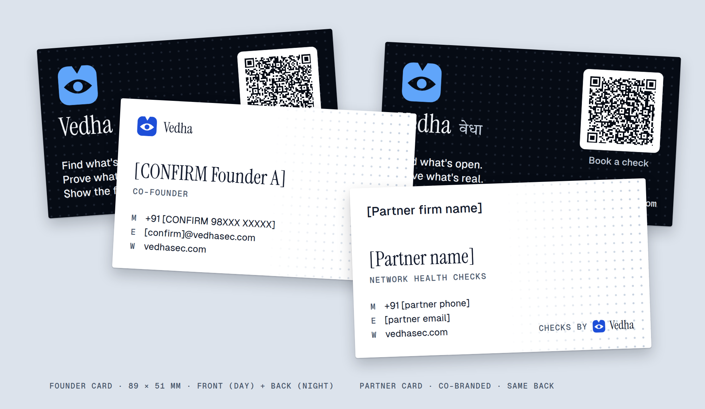

# Vedha visiting cards: design system, rationale and print spec



## 1. Objective

A card has two jobs, and both happen in seconds:
1. **Be remembered:** who this person is, and what Vedha does.
2. **Make the next step effortless:** save the contact (founders) or book a check (partners).

Everything not serving those two jobs was left out.

## 2. Brand system (locked: nothing new introduced)

| Token | Value | On the card |
|---|---|---|
| Seal | `vedha-mark.svg`, verbatim | Front (small, with wordmark) and back (large) |
| Blue | `#1D4ED8` (day) / `#60A5FA` (night) | The seal only. No blue text, no blue fills |
| Night | `#060B14` | Back background |
| Day / paper | white stock | Front background (see decision D3) |
| Teal `#0F766E` | — | **Not used.** Teal means "verified"; a card verifies nothing |
| Purple | — | Not used (AI only) |
| Fonts | Instrument Serif (names, wordmark), Geist (contacts, tagline), Geist Mono (labels), Tiro Devanagari Hindi (वेधा) | Same as the site and the film |
| Motif | Pulli-style dot lattice, from the film | Faint texture, both sides |

## 3. Information hierarchy

**Front (Day): the person.** 1) Name, 2) Role, 3) Phone / email / web, 4) Brand (small, top-left).
**Back (Night): the brand.** 1) Seal, 2) Vedha वेधा, 3) The promise in three lines, 4) One action (the QR), 5) URL.

## 4. Decisions and reasons

| # | Decision | Reason (research or brand) | Trade-off |
|---|---|---|---|
| D1 | **Two-sided: Day front (person), Night back (brand)** | Mirrors the site's and film's dark-to-light story. The person is the reason the card exists, so they get the readable side | Two-sided printing costs a little more |
| D2 | **Few elements, high contrast** (17.9:1 name, 18.2:1 tagline) | Text that's easier to process is judged more credible: statements in high-contrast colours were rated true more often (Reber & Schwarz, 1999, *Consciousness and Cognition*). For a security brand, credibility is the product | Less "decoration" |
| D3 | **Front on plain white stock, not a printed `#F3F6FA` tint** | A light tint on uncoated stock prints dull and patchy; white paper is the cleanest "Day". The front also stays writable (in India, people write notes on cards) | — |
| D4 | **Names in Instrument Serif 17 pt; everything small in Geist** | Serif at display size carries the brand voice; small serifs lose strokes in print, so small text is sans | — |
| D5 | **Reversed (light-on-dark) text is never below 8 pt, the tagline is 9 pt, and no small serif is reversed** | Ink spreads into reversed letters and thins them; guidance is +1–1.5 pt for reversed type and a 7–8 pt floor ([4over4](https://www.4over4.com/article/what-size-font-on-a-business-card), [CreativePro](https://creativepro.com/setting-readable-reversed-type/)) | The tagline can't be smaller |
| D6 | **QR on the back, 20 mm with a 2 mm white quiet zone, dark-on-white** | 2 cm is the business-card minimum (scanned from about 20 cm, the 10:1 rule); ISO needs a 4-module quiet zone ([Bitly](https://bitly.com/blog/minimum-size-for-qr-code/), [Replug](https://replug.io/blog/standard-qr-code-size)). Inverted (light-on-dark) codes fail on some phone readers, hence the white tile | The tile is the brightest thing on the back |
| D7 | **Founder QR = lean vCard ("Save contact"); partner QR = booking link with the partner's ID** | One action per card. A full vCard made a version-10 code (0.35 mm modules) that **failed** decode tests; the lean vCard is version 7–8 (0.41–0.44 mm) and passes. Partner links carry `utm_content=<partner>` so analytics (#6) can credit each partner | Founder title and URL aren't inside the vCard (the URL is printed) |
| D8 | **Partner card: partner's identity on the front, Vedha's back unchanged** | Partners sell under their own name (they keep the client); a consistent Vedha back builds recognition across every partner's card. "CHECKS BY [seal] Vedha" is the co-brand line | Partner logos must be supplied as vector (SVG/PDF) |
| D9 | **Lattice: faint texture (1.3–1.6:1), complete, no "door" on the cards** | It carries the film's identity without competing with text. A door-sill dash read as a print flaw at card scale in review, so it was removed | — |
| D10 | **वेधा beside "Vedha" on the back, smaller and lighter** | Bilingual identity, owner-chosen spelling; the Latin name stays primary for search and email | — |
| D11 | **Card weight: 350–400 gsm matte, optional spot UV on the seal** | Heavier objects were judged "more important" in Ackerman, Nocera & Bargh (*Science*, 2010), **but a later replication failed**, so treat this as a cheap bet, not proven. Spot UV makes the seal the one tactile detail | Thicker stock costs more |

## 5. Layout and grid (mm, from the trim edge)

- **Sizes:** 89 × 51 mm (3.5 × 2 in) and 90 × 55 mm (common in India). Ask your printer; both are generated from one layout.
- **Bleed:** 3 mm every edge (artboard 95 × 57 / 96 × 61 mm). **Safe area:** 5 mm inside the trim; all text, the seal and the QR stay inside it (verified on the `_guides.png` previews: red dashes = trim, orange dots = safe).
- **Anchors:** brand and QR anchored top; contacts, tagline and URL anchored bottom. That's why the same layout works at both heights.

## 6. Print spec (send this to the printer)

| Item | Spec |
|---|---|
| Files | `out/<person>_<size>_front.pdf` and `_back.pdf`: vector, fonts embedded, 3 mm bleed, no crop marks (add them if your printer asks) |
| Colour | Files are RGB (from the browser). **Ask the printer to convert to CMYK and approve a printed proof.** Starting values below |
| Back background | Rich black **C60 M40 Y40 K100** ([4over4](https://v2.4over4.com/guide/cmyk-values-for-print-explained)). Small white text is knocked out of it (fine at 8 pt and up) |
| Small text on the front | 100% K is better than rich black for small text; the ink colour `#0F172A` can be printed as K100 |
| Blue seal (day) | `#1D4ED8` ≈ C87 M64 Y0 K15 (naive conversion; match on the proof) |
| Blue seal (night) | `#60A5FA` ≈ C62 M34 Y0 K2 (match on the proof) |
| Stock | 350–400 gsm, matte or uncoated (writable front); optional soft-touch lamination on the back only |
| Finish (optional) | Spot UV on the night seal |
| Minimum sizes | Text ≥ 7 pt (front labels), ≥ 8 pt reversed; QR 20 mm |

## 7. Contrast (computed, WCAG ratio)

Name/contacts on white 17.9 · role/labels on white 7.6 · tagline on night 18.2 · captions and वेधा on night 12.6 · seal on white 6.7 · seal on night 7.8. Lattice dots are texture by design (1.3–1.6), never information.

## 8. QA (run it)

```bash
cd marketing && node cards/build.mjs && node cards/verify_qr.mjs
```

- QR decode test (independent reader, jsQR), at 60%, 40% and 30% scale with camera-like blur: **18 of 18 decode**. The raw, perfectly sharp 300 dpi raster trips the reader on 2 founder backs; no camera sees an image that sharp. **Still scan the printer's proof with two real phones (one Android, one iPhone) before the full run.**
- Safe-area check: `_guides.png` previews, every element inside the orange line (done for both sizes).

## 9. Before printing

- [ ] Replace every `[CONFIRM …]` in `people.json` (names, phones, emails), then rebuild. The vCard QR is generated from these values
- [ ] Choose 89 × 51 or 90 × 55 with your printer
- [ ] Approve a printed proof: colour of the blue seal, rich black, and a real-phone QR scan
- [ ] Partner cards: get the partner's logo as vector; until then the firm name is set in Geist Medium
